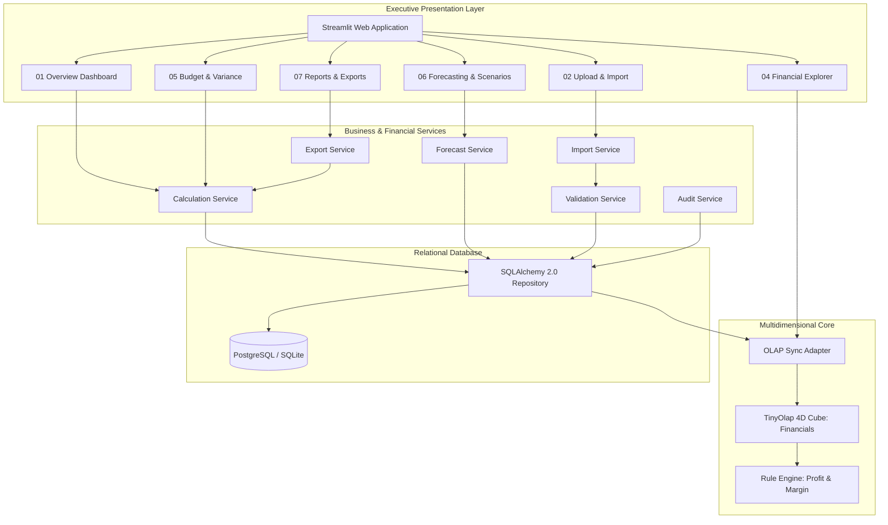
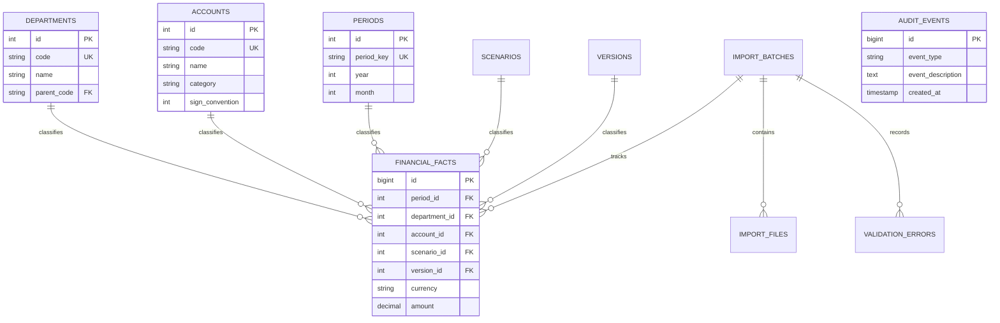

# Architecture Overview & Technical Design

**Enterprise Financial Planning & Forecasting Engine**  
**Company:** Northstar Digital Services GmbH  
**Architect:** Arnab Saha  

---

## 1. System Architecture Diagram

---

## 2. Multidimensional Cube Design (IBM TM1 Parity)

The core analytical model is represented as a 4-dimensional hypercube:

$$\mathbf{Cube}(\text{Account}, \text{Department}, \text{Period}, \text{Scenario})$$

### Dimensions & Consolidations

1. **Account Dimension**:
   - `REV` (Numeric Leaf, Weight $+1.0$)
   - `TOTAL_OPEX` (Consolidation, Weight $+1.0$)
     - `SAL` (Salaries and Benefits, Weight $+1.0$)
     - `CLOUD` (Cloud Infrastructure, Weight $+1.0$)
     - `SW` (Software Subscriptions, Weight $+1.0$)
     - `MKT_EXP` (Marketing Expenses, Weight $+1.0$)
     - `RENT` (Rent and Facilities, Weight $+1.0$)
     - `TRAVEL` (Travel & Entertainment, Weight $+1.0$)
     - `PROF` (Professional Services, Weight $+1.0$)
     - `DEPR` (Depreciation, Weight $+1.0$)
     - `INSUR` (Insurance, Weight $+1.0$)
     - `TRAIN` (Training & Development, Weight $+1.0$)
     - `OTHER` (Other Operating Expenses, Weight $+1.0$)
   - `Operating Profit` (Calculated Rule)
   - `Operating Margin` (Calculated Rule)

2. **Department Dimension**:
   - `COMPANY` (Consolidated Parent, Weight $+1.0$)
     - `ENG` (Engineering, Weight $+1.0$)
     - `SALES` (Sales, Weight $+1.0$)
     - `MKT` (Marketing, Weight $+1.0$)
     - `OPS` (Operations, Weight $+1.0$)
     - `FIN` (Finance, Weight $+1.0$)

3. **Period Dimension**:
   - Monthly grain from `2024-01` through `2026-12` (36 months).

4. **Scenario Dimension**:
   - `Actuals`
   - `Original Budget`
   - `Revised Budget`
   - `Forecast v1`
   - `Optimistic Scenario`
   - `Conservative Scenario`

---

## 3. Relational Schema & Constraints

The relational store ensures permanent durability, relational integrity, and auditability:

