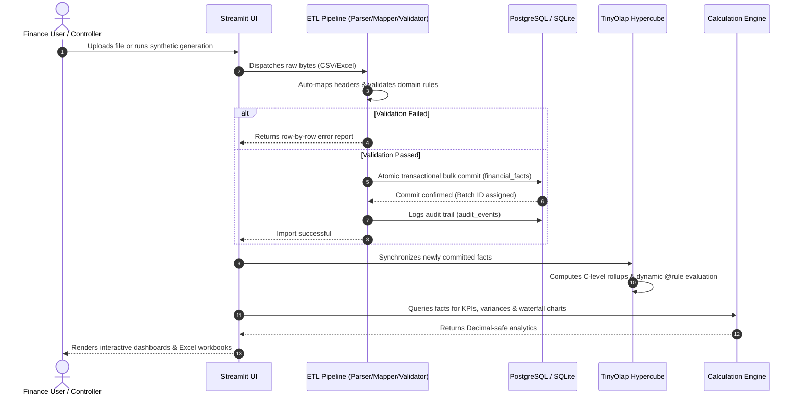

# Data Flow Architecture & Lifecycle

**Enterprise Financial Planning & Forecasting Engine**  
**Northstar Digital Services GmbH**  

---

## 1. End-to-End Data Pipeline

The data lifecycle spans six sequential stages from raw ingestion to multidimensional reporting:

---

## 2. Detailed Stage Breakdown

### Stage 1: Extraction & Ingestion
* Financial facts originate from ERP extracts (SAP, NetSuite, Oracle) or generated synthetic fixtures.
* Handled by `etl/file_parser.py`: Supports CSV with diverse delimiters and multi-tab Excel workbooks (`.xlsx`, `.xls`). Reads with string preservation to avoid loss of leading zeros in account/department codes.

### Stage 2: Normalization & Mapping
* Handled by `etl/column_mapper.py`: Fuzzy alias dictionaries match enterprise column names (e.g. `Cost Center` $\to$ `department`, `GL Account` $\to$ `account`, `Total Amount` $\to$ `amount`).
* Target fields: `department`, `account`, `period`, `date`, `scenario`, `version`, `currency`, `amount`.

### Stage 3: Domain Validation
* Handled by `etl/validator.py`: Evaluates rows against referential integrity constraints:
  - Department code exists in active master (`DEPARTMENTS`).
  - Account code exists in chart of accounts (`ACCOUNTS`).
  - Period conforms to `YYYY-MM` within supported planning horizons.
  - Currency conforms to ISO 4217 (`EUR`, `USD`, `GBP`, `CHF`).
  - Amounts are convertible to signed `Decimal`.

### Stage 4: Transactional Loading & Duplicate Resolution
* Handled by `etl/loader.py`:
  - `REJECT` (Default): Aborts batch if any grain collision occurs.
  - `SKIP`: Ignores incoming duplicate records.
  - `REPLACE`: Overwrites existing records at that grain.
  - Transactions ensure atomic commits; failure at row 9,999 rolls back all rows.

### Stage 5: Multidimensional Cube Hydration
* Handled by `olap/adapter.py`: Relational facts populate cell coordinates in the in-memory 4D hypercube.
* Consolidations (`COMPANY`, `TOTAL_OPEX`) calculate instantaneously.
* Rule functions evaluate calculated accounts (`Operating Profit`, `Operating Margin`).

### Stage 6: Presentation & Export
* Streamlit dashboards query both relational tables and the cube to render Plotly charts, KPI summary cards, and multi-sheet styled Excel workbooks.
