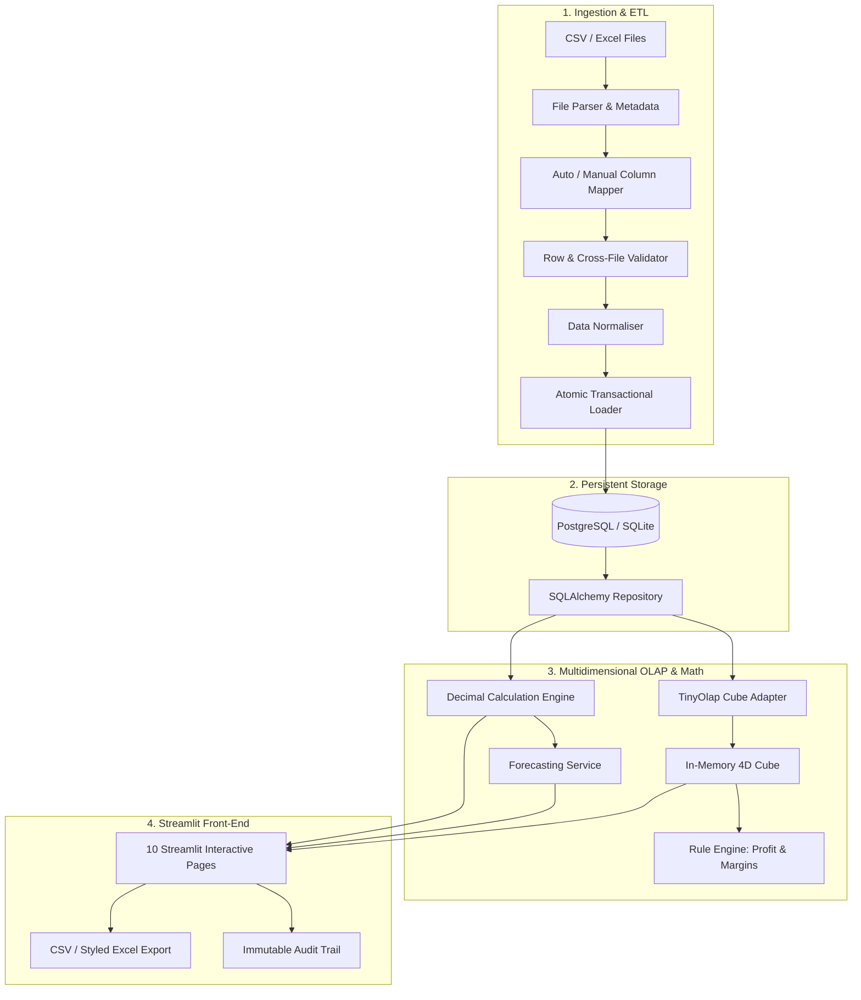

# System Architecture & Key Engineering Decisions

**Project:** Enterprise Financial Planning & Forecasting Engine  
**Fictional Enterprise:** Northstar Digital Services GmbH  
**Architect:** Arnab Saha  
**Stack:** Python 3.10+, TinyOlap (OLAP/TM1 Parity), PostgreSQL / SQLite, SQLAlchemy 2.0, Streamlit, Plotly, Pandas, Alembic

---

## 1. Executive Summary & How the System Works

The **Enterprise Financial Planning & Forecasting Engine** is a production-grade multidimensional financial planning, budgeting, forecasting, and variance analysis system. Designed to mirror enterprise Corporate Performance Management (CPM) platforms such as **IBM Planning Analytics (TM1)**, **Anaplan**, and **SAP BPC**, the system provides:

1. **Transactional Ingestion & ETL Pipeline**: Secure upload of financial CSV and Excel workbooks, automatic header mapping, strict row-level domain validation, atomic PostgreSQL/SQLite transactional persistence, and detailed validation reports.
2. **Deterministic Seed-Controlled Synthetic Generator**: Produces 36 months of realistic multi-department, multi-account financial facts with seasonality curves, growth rates, and deliberate demonstration events (e.g. Q3 2025 cloud cost surge, sales overachievement).
3. **Multidimensional OLAP Cube (TinyOlap)**: In-memory cube modeling with N-level (numeric leaves) and C-level (consolidations) hierarchies across Accounts, Departments, Time Periods, and Scenarios, powered by `@rule` calculations for dynamic KPIs.
4. **Certified Financial Calculations**: Precision `Decimal` arithmetic for signed variance, percentage variances, margin metrics, and explicit favourability logic adhering to corporate finance standards.
5. **Three-Tier Forecasting Engine**:
   - **Baseline Extrapolation**: Linear trend projection from historical actuals.
   - **Assumption-Driven**: Compound growth formulas based on key operating assumptions (e.g., inflation rates, hiring plans).
   - **Scenario Modeling**: Multi-scenario side-by-side analysis (Actuals, Budget, Forecast v1, Optimistic, Conservative).
6. **Executive Streamlit UI**: 10 purpose-built screens featuring custom CSS glassmorphism/slate design tokens, drill-down tables, waterfall variance charts, scenario modeling sandboxes, and immutable audit logs.

---

## 2. Key Engineering & Architectural Decisions

### Decision 1: Decimal-Safe Arithmetic Over Binary Floating Point
- **Context:** Python's standard `float` data type uses IEEE 754 64-bit binary floating-point representation. Calculations such as `0.1 + 0.2` yield `0.30000000000000004`.
- **Decision:** All financial quantities, rates, variances, and aggregates are strictly represented as `decimal.Decimal` with explicit rounding modes (`ROUND_HALF_UP`) and 2 decimal places for currency, 4 decimal places for rates.
- **Why it matters:** Financial reports must balance to the exact cent across millions of rows. Rounding discrepancies destroy trust with CFOs, controllers, and auditing bodies.

### Decision 2: Financial Sign Convention Standard & Inverted Favourability
- **Context:** In financial reporting, revenue and expenses have opposite cash flow directions. Naive subtraction (`Actual - Budget`) misclassifies expense variances.
- **Decision:**
  - **Revenue** is positive ($+$).
  - **Operating Expenses** are negative ($-$).
  - **Operating Profit** = $\text{Revenue} + \text{Expenses}$ (e.g. $1,000,000 + (-700,000) = 300,000$).
  - **Signed Variance** = $\text{Actual} - \text{Budget}$.
  - **Variance Favourability Rule**:
    - For **Revenue** and **Profit**: Variance $> 0 \implies \mathbf{Favourable}$ (Green); Variance $< 0 \implies \mathbf{Unfavourable}$ (Red).
    - For **Operating Expenses**: Actual expenses that are *more negative* than budget represent overspending: Variance $< 0 \implies \mathbf{Unfavourable}$ (Red); Variance $> 0$ (less negative, underspending) $\implies \mathbf{Favourable}$ (Green).
- **Why it matters:** If an engineering team budgeted $-€50,000$ for cloud costs but spent $-€55,000$, the signed variance is $-€5,000$. Calling this "positive" or misrepresenting favourability is a critical financial bug.

### Decision 3: Dual Database Strategy (SQLite for Local / Dev / Tests; PostgreSQL for Production)
- **Context:** Requiring a running PostgreSQL instance for local development or automated CI tests slows down development and increases friction.
- **Decision:** Implemented an environment-driven SQLAlchemy 2.0 connection manager that defaults gracefully to zero-configuration `sqlite:///northstar_local.db` while natively supporting hosted PostgreSQL (Neon, AWS RDS, Supabase) via `psycopg` driver when `DATABASE_URL` is configured.
- **Why it matters:** Ensures one-command setup for pair programming and CI/CD while ensuring seamless production deployment on cloud environments.

### Decision 4: Multidimensional OLAP Modeling with TinyOlap (IBM TM1 Parity)
- **Context:** Relational SQL `GROUP BY` queries become cumbersome and slow when evaluating multidimensional hierarchies across Accounts, Departments, Time, and Scenarios with dynamic rules.
- **Decision:** Implemented an in-memory multidimensional cube using **TinyOlap**:
  - Dimensions: `Account` (Hierarchical: Total -> Revenue, Total Expenses -> Sal, Cloud, etc.), `Department` (Company -> ENG, SALES, MKT, OPS, FIN), `Month` (36 months), `Scenario` (Actuals, Original Budget, Revised Budget, Forecasts).
  - Calculated elements powered by `@rule` decorators (e.g. `Operating Profit` and `Operating Margin`).
  - Read-through and write-back synchronization adapter bridging the relational database and the OLAP cube.
- **Why it matters:** Provides authentic IBM Planning Analytics / TM1 architectural experience within modern Python.

### Decision 5: Atomic, Transactional 8-Step ETL Pipeline with Configurable Duplicate Policies
- **Context:** Real-world enterprise financial data frequently arrives with dirty formatting, missing headers, unmapped accounts, and duplicate periods.
- **Decision:**
  - Implemented an 8-step pipeline: (1) Upload $\to$ (2) Inspect $\to$ (3) Auto/Manual Map $\to$ (4) Validate $\to$ (5) Preview $\to$ (6) Correct $\to$ (7) Transactional Commit $\to$ (8) Audit Trail.
  - Three distinct duplicate policies: `REJECT` (default, fail-safe), `SKIP` (ignore duplicate grain), `REPLACE` (upsert existing facts).
  - Atomic transactions ensure that if row 9,999 of 10,000 fails validation, the entire batch is rolled back with zero orphaned records.
- **Why it matters:** Guarantees data integrity and prevents corrupting historical actuals.

### Decision 6: Three Complementary Forecasting Methodologies
- **Context:** Financial planning requires different forecasting techniques depending on business maturity, seasonality, and macroeconomic shifts.
- **Decision:**
  - **Method 1 (Baseline Extrapolation)**: Computes a rolling linear regression trend from historical actuals.
  - **Method 2 (Assumption-Driven)**: Calculates future periods by compounding growth rates against baseline periods ($P_t = P_{t-1} \times (1 + g)$).
  - **Method 3 (Scenario Simulation)**: Allows setting custom drivers per department/account (e.g. hiring freeze in Sales, 20% cloud optimization in Engineering, 15% revenue expansion) and compares outcomes against baseline budgets.
- **Why it matters:** Gives management immediate scenario agility during quarterly and annual planning cycles.

### Decision 7: Enterprise Glassmorphism UI & Executive Visual Hierarchy
- **Context:** Standard Streamlit apps often look like toy prototypes with raw widgets and standard tables.
- **Decision:** Implemented a unified design token system (`components/styles.py`) utilizing dark navy (`#0f1729`), card slate (`#1e293b`), crisp typography (Inter & JetBrains Mono for figures), custom variance badges (`favourable` / `unfavourable`), interactive Plotly charts, and drill-down tables.
- **Why it matters:** Elevates the application to an executive-ready enterprise product suitable for C-suite presentations and portfolio demonstration.

---

## 3. End-to-End Data Lifecycle

1. **Generation / Upload**: Synthetic generator or external files provide monthly grain facts: `(period, department, account, scenario, version, currency, amount)`.
2. **Schema Ingestion**: File parser detects file formats, inspects worksheets, computes row hashes, and normalizes headers.
3. **Validation & Filtering**: The validator checks against dimension master tables, identifies missing foreign keys, validates date intervals (2024-01 to 2026-12), checks number formats, and returns row-by-row error logs.
4. **Storage & Audit**: Accepted rows are bulk-inserted in a single transaction; import batch metadata and audit events are recorded.
5. **Cube Hydration**: The OLAP adapter synchronizes relational records into the in-memory multidimensional cube for instant aggregation across rollup hierarchies.
6. **Reporting & Analysis**: Streamlit dashboards query both the repository and the cube to render interactive KPI cards, waterfall variance charts, scenario comparison views, and formatted Excel exports.

---

*Authored for the Northstar Digital Services GmbH Enterprise Financial Planning Engine.*
